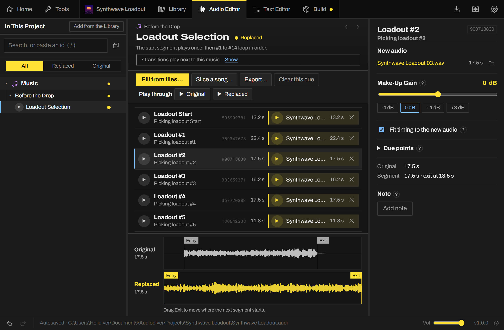

<h1 align="center">Audiodiver</h1>

Replace any music, sound or voice in Helldivers 2 and build a mod for HD2 Arsenal, 
without Wwise or a hex editor.

<a href="https://github.com/Alomare/Audiodiver/releases/latest"><b>Download</b></a>
&nbsp;·&nbsp;
<a href="https://discord.gg/helldiversmodding">Discord</a>
&nbsp;·&nbsp;
<a href="https://github.com/Alomare/Audiodiver/issues">Report a bug</a>

## What you can do

- Find anything the game plays, from music and weapons to enemies, voices and ambience, sorted by what it is. Play
  any of it.
- Replace it with your own audio, or add new takes and layers to a sound. Audiodiver converts your files and works out
  the sound banks, ids and timing the game needs.
- Hear a whole piece of music the way the game plays it, with the same hand-overs between segments. Compare the
  original and your audio on one waveform.
- Slice one long song into the segments of a piece of music, so it plays without gaps.
- Change subtitles and any other line of the game's text, in every language.
- Build a ZIP that HD2 Arsenal installs, with your mod's name and icon.
- After a game update, rebuild your project, or repatch an older mod for the current game. Combine several audio mods
  that change the same sounds into one.

Audiodiver only reads the game's files. It never writes to the game's folder.

 
The Library lists everything the game plays and says how each piece is put together.

 
The Text Editor shows a changed line the way the game will.

## Getting started

You need Windows 10 or 11, Helldivers 2 installed through Steam, and
[HD2 Arsenal](https://github.com/Orbit-Studios/hd2arsenal-release/releases) to install the mods you build.

1. Download the installer from [Releases](https://github.com/Alomare/Audiodiver/releases/latest) and run it. The
   portable ZIP works too, and keeps everything in its own folder. The installer isn't code-signed yet, so Windows
   may say it protected your PC: choose **More info**, then **Run anyway**.
2. Start Audiodiver. It finds the game through Steam and reads its audio, which takes about a minute the first time.
3. On Home, choose **New project**.
4. In the Library, find what you want to change and press **Add to the project**.
5. In the Audio Editor, drop your audio files on its slots.
6. Press **Build**, then import the ZIP in HD2 Arsenal and deploy it.

The Wiki inside the app (F1) walks through a first mod step by step, and explains how the game plays its music.

Everything Audiodiver runs comes with it. Its window uses the Microsoft Edge WebView2 Runtime, which Windows 11 has
and nearly every Windows 10 PC has too. If yours doesn't, Audiodiver shows a link to
[Microsoft's free download](https://developer.microsoft.com/microsoft-edge/webview2/).

## Questions and feedback

Ask on the [Helldivers 2 Modding Discord](https://discord.gg/helldiversmodding). Bugs go to
[Issues](https://github.com/Alomare/Audiodiver/issues). To support Audiodiver, there's
[Ko-fi](https://ko-fi.com/alomare).

Bug reports, ideas and pull requests are welcome. [CONTRIBUTING.md](CONTRIBUTING.md) covers building from source and
what a pull request needs.

## Credits

Audiodiver builds on the research and tools of the Helldivers 2 modding community, among them
[hd2-audio-modder](https://github.com/RaidingForPants/hd2-audio-modder) by RaidingForPants,
[wwise-teller](https://github.com/Dekr0/wwise-teller) by Dekr0, [wwiser](https://github.com/bnnm/wwiser) by bnnm and
[FileDiver](https://github.com/xypwn/filediver) by xypwn. The app lists everyone under About ▸ Credits.

## Licence

Audiodiver is free software under the [Mozilla Public License 2.0](LICENSE). Anyone who shares it, changed or not,
has to keep its files open under the same licence. The licence doesn't cover the mods you build with it.

`core/audiodiver/_vendor/slim.py` comes from hd2-audio-modder, under the MIT License
(`core/audiodiver/_vendor/LICENSE-hd2-audio-modder`). The Home pictures (`app/src/art/`) are screenshots of
Helldivers 2 by the author; the game in them belongs to Arrowhead Game Studios.

Audiodiver is a fan-made tool, not affiliated with or endorsed by Arrowhead Game Studios or Sony Interactive
Entertainment. HELLDIVERS is a trademark of Sony Interactive Entertainment LLC.
