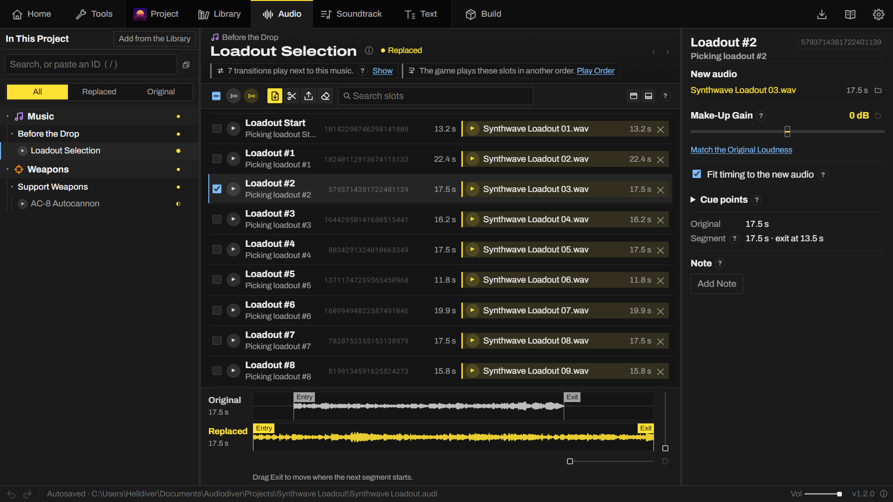
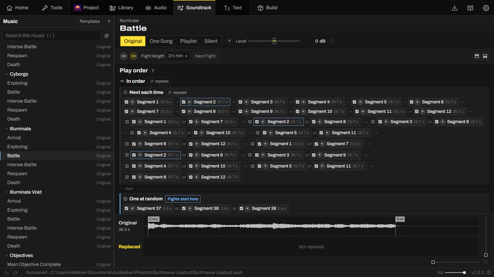
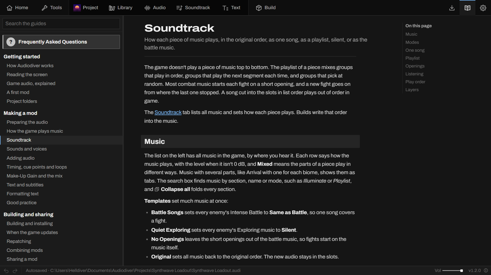
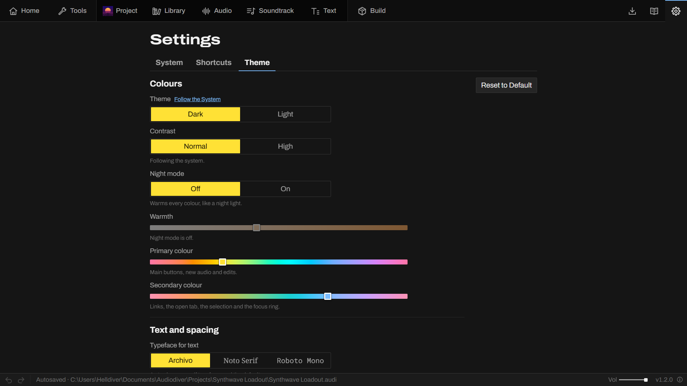
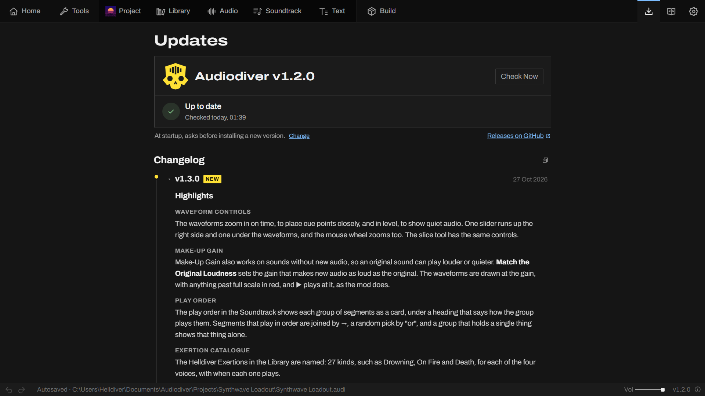

<p align="center">
  
</p>

<h1 align="center">Audiodiver</h1>

<p align="center">Helldivers 2 audio and text archive explorer, editor and mod builder.</p>

<p align="center">
  
  
  
  <a href="https://github.com/Alomare/Audiodiver/releases/latest"></a>
</p>

<p align="center">
  <a href="https://discord.gg/helldiversmodding"></a>
</p>

<p align="center">
  <a href="https://github.com/Alomare/Audiodiver/releases/latest"><b>Download</b></a> ·
  <a href="#how-to-use">How to Use</a> ·
  <a href="https://github.com/Alomare/Audiodiver/issues">Report a Bug</a>
</p>

<br>

<p align="center">
  
</p>

<p align="center">
  <a href="#features">Features</a> ·
  <a href="#how-it-works">How It Works</a> ·
  <a href="#how-to-use">How to Use</a> ·
  <a href="#questions-and-feedback">Questions and Feedback</a> ·
  <a href="#contributing">Contributing</a> ·
  <a href="#credits">Credits</a>
</p>

<br>

## Features

### 📁 Project

The mod's name, description, icon and ID, with a preview as a mod manager shows them. The project folder has **Collect Files**, a clean-up to the Recycle Bin, and packs (`.audipack`) for another computer.


### 📚 Library

Every sound in Helldivers 2, sorted. Music goes by when it plays, from the ship to extraction, and weapons by loadout slot, then stratagems, enemies and planets. Search takes a name, a label or an ID.


### 🎚️ Audio

The music and sounds of a project, one slot per clip. An audio file dropped on a slot, a sound or a whole piece replaces the original, and one song can be cut across a whole piece. Slots take silence and Make-Up Gain too, and sounds can get new takes and layers. Under the slots, the original and the new audio are drawn on one time scale, with a zoom in time and level.



### 🎼 Soundtrack

How each piece of music plays in a mission: in the original order, as one song, as a playlist of whole songs, or silent. The play order shows how the game picks each next segment, and unticking a segment leaves it out. Drag songs to put a playlist in order, and listen to a whole fight with the original music or the new one before anything is built.



### 📝 Text

All text in Helldivers 2, in 15 languages, subtitles included. A formatting bar, a preview as the line shows in game, and links between voice lines and subtitles.


### 📖 Wiki

Guides inside the app, from a first mod to what to do after a game update, and a page of frequently asked questions. Every ? next to a setting opens the matching section, and Ctrl+F finds and marks words on a page.



### ⚙️ Settings

The theme sets dark or light, high contrast, a night mode that warms every colour, the two colours of the app, the typefaces, the text size, the spacing and where the tab bar goes. The other settings hold the game folder, the tabs that show, autosave, tooltips and disk space, and every shortcut key can be rebound.



### 🔄 Updates

New versions, looked for at every start. Audiodiver asks before installing one, installs it by itself, or only lights up this tab, as set in Settings. The tab also lists the changes in every version.



### 🧰 Audiodiver Utils

The two tools of the Tools tab on their own, for players who only need to fix or merge mods: a 27 MB portable window, and a command line.

#### Repatch

A mod for an older game version, rebuilt on the current sound banks with the same audio, settings, options and ID. Text, models and textures stay as they were. **Installed mods** finds the mods that need it.


#### Combine Mods

Several mods that change the same sound banks, built as one with the options chosen in the mod manager, text, models and textures included. Where two change the same sound, you play both versions and pick one.


#### Command Line

`audiodiver.cmd` runs the same tools from a command line, so scripts and mod managers can call them:

```
audiodiver.cmd check --json                        installed mods that need a repatch
audiodiver.cmd repatch "Old Mod.zip" --json        the mod rebuilt for the current game
audiodiver.cmd combine "A.zip" "B.zip" --json      one mod out of several
audiodiver.cmd scan "A.zip" --json                 a mod's options, for a combine plan
```

With `--json` the result is JSON on stdout and progress goes to stderr. A plan file sets each mod's options and who
wins each clash. [core/command-line.md](core/command-line.md) has every option, the plan format and what each
command returns.

<br>

## How It Works

- Audiodiver finds Helldivers 2 through Steam and reads the game archives.
- On first startup, the core indexes every sound bank, stream and object, with names
  from the modding community's research. It indexes again after each game update.
- A build takes the current sound banks, puts the new audio and timing in, and reads the result back to check it
  before packing the ZIP. That's why rebuilding after an update is usually all a mod needs.
- wav2wem encodes new audio to Wwise Vorbis, vgmstream plays the original audio, and FFmpeg reads everything else.
  All three come with Audiodiver.
- A Python core reads, patches and builds, and the window is Tauri 2 with React. They talk over a local connection
  protected by a token.
- More than 200 tests, among them byte-for-byte builds of three complete music mods.

## How to Use

You need Windows 10 or 11, Helldivers 2 installed through Steam, and a Helldivers 2 mod manager to install the mods
you build.

1. Download Audiodiver from [Releases](https://github.com/Alomare/Audiodiver/releases/latest) and run it. The installer
   isn't code-signed yet, so Windows may say it protected your PC: choose **More info**, then **Run anyway**.
2. Start Audiodiver. It finds the game through Steam and reads the audio, which takes about a minute the first time.
3. On Home, choose **New Project**.
4. In the Library, find what you want to change and press **Add to the Project**.
5. On the Audio tab, drop audio files on the slots.
6. Press **Build**, then import the ZIP in the mod manager and deploy it.

The Wiki (F1) has a first mod step by step, how music plays in a mission, how loud new audio should be, what to do
after a game update, and answers to frequent questions.

| Download | What it is |
|---|---|
| `Audiodiver_<version>_x64-setup.exe` | The installer. It adds Audiodiver to the Start menu, opens projects and packs from Explorer, and checks for new versions at startup, then installs them when you say so (or without asking, with Updates set to Automatic in Settings ▸ System). |
| `Audiodiver-<version>-portable.zip` | The portable copy, with settings and caches in the same folder. Unzip it anywhere and start `Audiodiver.exe`. New versions are downloaded by hand. |
| `Audiodiver-Utils-<version>-portable.zip` | Audiodiver Utils: Repatch and Combine Mods without projects, as a smaller portable window (`Audiodiver Utils.exe`) and a command line (`audiodiver.cmd repatch <mod>`, `combine`, `check`, `scan`, with `--json` for scripts and mod managers). |

The window needs the Microsoft Edge WebView2 Runtime, which Windows 11 has and nearly every Windows 10 PC has too. If
yours doesn't, Audiodiver shows a link to [Microsoft's free download](https://developer.microsoft.com/microsoft-edge/webview2/).
Everything else comes with Audiodiver.

## Questions and Feedback

### Asking for Help

Ask on the [Helldivers 2 Modding Discord](https://discord.gg/helldiversmodding) how to do something, or show what you
made. Refer to the in-app Wiki before doing so.

### Reporting a Bug

Open a [bug report](https://github.com/Alomare/Audiodiver/issues/new?template=bug_report.yml). The form asks for the
version, what you did and what happened, and the log file (About ▸ Log file ▸ Show finds it).

If an audio mod doesn't work properly, build it again first, since Helldivers 2 may have updated since the last build. If it
still sounds wrong, then fill and submit the form.

### Suggesting an Idea

Open an [idea](https://github.com/Alomare/Audiodiver/issues/new?template=idea.yml) with what you'd like Audiodiver to
do.

### Supporting Audiodiver

Audiodiver is 100% free, no caveats. If you'd like to support it, buy me a [Ko-fi](https://ko-fi.com/alomare)!

## Contributing

### Without Code

- Report bugs, odd sounds and confusing screens, in an issue or on the Discord.
- Fix names. Library names come from research and the community's
  [Archive Labeling](https://docs.google.com/spreadsheets/d/1oQys_OI5DWou4GeRE3mW56j7BIi4M7KftBIPAl1ULFw/edit?gid=0#gid=0)
  and [Music Stuff](https://docs.google.com/spreadsheets/d/1drg0VRwn1c247GwBOEgFBIJmBQxy2Ik-ZLuSjbWbK4o/edit?gid=329417206#gid=329417206)
  spreadsheets. If a sound is in the wrong place, or has the wrong name or none, open a
  [Wrong or missing name](https://github.com/Alomare/Audiodiver/issues/new?template=wrong_name.yml) issue.
- Edit the Wiki. The pages are Markdown files in [`app/src/wiki/`](app/src/wiki/), and a clearer sentence or a
  missing step is a good first pull request.
- Help others on the Discord.

### With Code

You need Windows with Helldivers 2 from Steam, Python 3.12+, Node.js 20+ and Rust, and ffmpeg, vgmstream-cli and
wav2wem on your PATH.

```sh
pip install -e "core[test]"     # the core
cd app && npm install           # the window
npm run tauri dev               # the app, with hot reload
```

Before a pull request, run `python -m pytest core -q` and `npx tsc --noEmit` (in `app`), and try the change in the
app. [`app/README.md`](app/README.md) and [`core/README.md`](core/README.md) say what each file does, and the first
also has the writing and layout rules. Keep to one change per pull request, add a screenshot when it changes what the
app shows, and open an issue before a large change.

[CONTRIBUTING.md](CONTRIBUTING.md) has the details, including what the repository never takes: game files, other
people's mods, and anything without a license that allows it here.

<br>

<p align="center">
  <a href="https://discord.gg/helldiversmodding"></a>
  <br>
  Audio modders on the Discord share what they make, swap notes on Helldivers 2 music and help with first mods.
</p>

---

## Credits

Audiodiver builds on the research and tools of the Helldivers 2 modding community. The app lists them under
About ▸ Credits too.

| | By | What Audiodiver takes from it |
|---|---|---|
| [hd2-audio-modder](https://github.com/RaidingForPants/hd2-audio-modder) | RaidingForPants | Reading Helldivers 2 archives, and how they store sound banks. The archive reader in Audiodiver comes from it. |
| [wwise-teller](https://github.com/Dekr0/wwise-teller) | Dekr0 | Wwise property IDs, Volume against Make-Up Gain, and how new takes, layers and clips go into a bank. |
| [wwiser](https://github.com/bnnm/wwiser) | bnnm | The reference for Wwise sound bank structures. |
| [FileDiver](https://github.com/xypwn/filediver) | xypwn | The name lists behind the banks' path names. |
| [Sound Systems Rebalanced](https://github.com/CowboyBingus/SoundSystemsRebalanced) | CowboyBingus | The music's drop at the war table. |
| [Helldivers 2 Archive Labeling](https://docs.google.com/spreadsheets/d/1oQys_OI5DWou4GeRE3mW56j7BIi4M7KftBIPAl1ULFw/edit?gid=0#gid=0) | the HD2 modding community | Names of sound sets, banks and archives, and voice line transcripts. |
| [Helldivers 2 Music Stuff](https://docs.google.com/spreadsheets/d/1drg0VRwn1c247GwBOEgFBIJmBQxy2Ik-ZLuSjbWbK4o/edit?gid=329417206#gid=329417206) | the HD2 modding community | Names of music clips, and the marks on clips not to touch. |
| Music notes | geoffreyhdt1 | Illuminate Void and Automaton clip names, when clips play, warnings and minimum lengths. |
| [Whisper](https://github.com/openai/whisper) | OpenAI | Hearing the voice lines, to match each one to a subtitle. |
| [Audio Spectrogram Transformer](https://huggingface.co/MIT/ast-finetuned-audioset-10-10-0.4593) | MIT | Telling grunts, breaths and laughs from words. |
| [FFmpeg](https://ffmpeg.org), [vgmstream](https://github.com/vgmstream/vgmstream), [wav2wem](https://github.com/pas2k/wav2wem) | | Reading, playing and encoding audio. They come with Audiodiver as separate programs. |
| Archivo, Noto Serif and Roboto Mono | | The typefaces, under the [SIL Open Font License](https://openfontlicense.org). |
| [Divershub](https://divershub.app) | | The ticker of war news along the bottom of Home. |

## License

Audiodiver is free software under the [Mozilla Public License 2.0](LICENSE). Anyone who shares it, changed or not,
has to keep the files open under the same license. The license doesn't cover the mods you build with it.

`core/audiodiver/_vendor/slim.py` comes from hd2-audio-modder, under the MIT License
(`core/audiodiver/_vendor/LICENSE-hd2-audio-modder`). FFmpeg, vgmstream and wav2wem keep their licenses (wav2wem is
under GPL-2.0), and their sources are at the links above.

<sub>Audiodiver is a fan-made tool, not affiliated with or endorsed by Arrowhead Game Studios or Sony Interactive
Entertainment. HELLDIVERS is a trademark of Sony Interactive Entertainment LLC.</sub>
